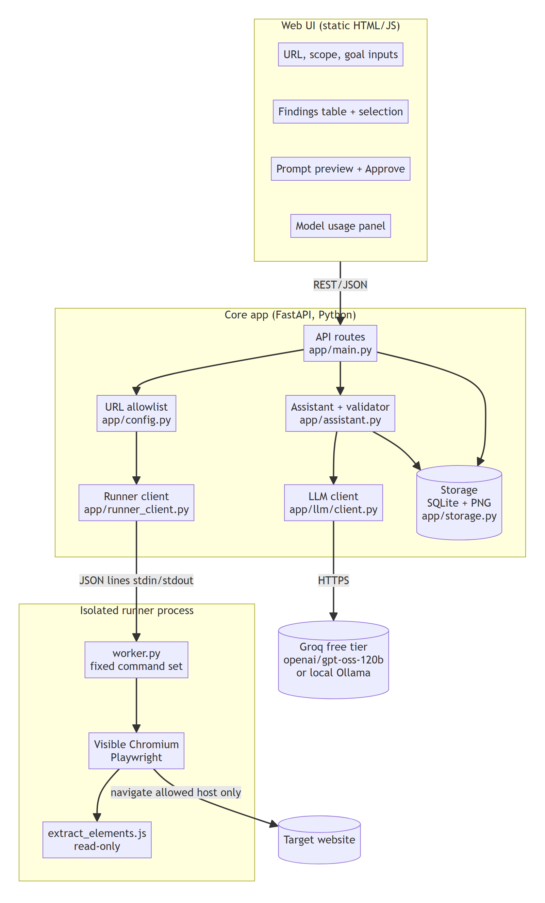
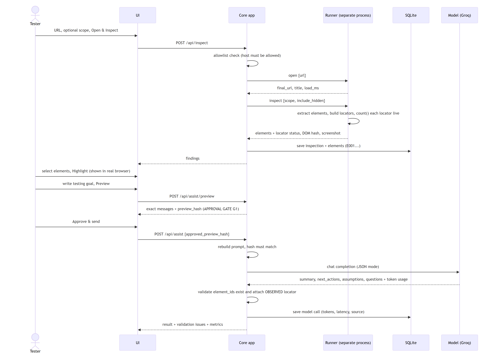

# Web Testing Assistant: Phase 1 Design Document

**Course:** Generative AI for Software Testing. **Phase 1:** architecture and guided inspection.

## 1. Purpose and scope

The assistant helps a **human tester** with five tasks:

1. Inspect a web page.
2. Design test cases.
3. Generate Playwright code.
4. Execute approved tests.
5. Maintain tests after the page changes.

The tester stays in control at every stage, and every model output is grounded in what the browser **actually observed**.

Phase 1 delivers the architecture and a working prototype of the first stage, **guided inspection**:

- open a URL in a visible browser,
- extract the interactive elements, their attributes and candidate locators,
- check each locator's uniqueness on the live page,
- let the tester choose elements and describe a goal,
- make a model call grounded in the stored inspection data, after the tester approves the exact prompt.

## 2. Component diagram

*Source: `docs/diagrams/1_component_diagram.mmd`. Re-render with `python docs/render_diagrams.py`.*

| Component | Responsibility | Files |
|---|---|---|
| Web UI | Input, findings display, element selection, prompt approval, usage metrics. Page text is inserted with `textContent` only, so it can never run as HTML or script. | `static/` |
| API | Routes, request validation, approval checks | `app/main.py`, `app/schemas.py` |
| Config | `.env` settings, target URL, host allowlist | `app/config.py` |
| Runner client | Starts the runner process, removes secrets from its environment, enforces timeouts and restarts it on failure | `app/runner_client.py` |
| Isolated runner | Visible Chromium. Accepts only `configure / open / inspect / highlight / ping / shutdown`. Blocks navigation to hosts that are not allowed. Can only write screenshots to `data/screenshots`. | `runner/worker.py` |
| Extractor | Reads the DOM: tag, role, accessible name, label, attributes, visibility, bounding box, CSS path | `runner/extract_elements.js` |
| Locator builder | Candidate locators in Playwright priority order (pure Python, unit-tested) | `runner/locators.py` |
| Storage | Inspections, elements, model calls (SQLite) and a JSONL usage log | `app/storage.py` |
| Assistant | Builds the prompt from stored data, checks the approval hash, validates that the answer only uses real element IDs | `app/assistant.py` |
| LLM client | One OpenAI-compatible client for Groq or Ollama; measures latency and tokens | `app/llm/` |

## 3. Data flow (Phase 1)

*Source: `docs/diagrams/2_data_flow.mmd`.*

### Inspection record (stored)

The stored record holds:

- **Inspection:** id, requested/final URL, title, scope, timestamp, DOM SHA-256 hash, screenshot, load and inspect times, and `page_text[]` (visible text blocks `T001`…, each with tag and text).
- **Per element:**
  - `element_id` (`E001`…), tag, type, implicit/explicit role, accessible name, label, text
  - attributes (`id`, `name`, `placeholder`, `aria-label`, `data-testid`, `href`, …), visible, bounding box, CSS path
  - `locators[]`, each with `kind`, `code`, live `count` and `status` (`unique` / `ambiguous` / `none` / `error`)
  - `recommended_locator`: the first candidate in priority order whose status is `unique`

A full example is in `samples/sample_inspection.json`.

## 4. Validation and grounding

1. **Locator validation.** Every candidate locator is run on the live page with Playwright `count()`:
   - only a count of exactly **1** is marked unique and can be recommended;
   - elements with no unique locator are flagged in the UI.

   *Example from the default site:* the guessed `get_by_role("button", name="Login")` returned 0 matches, because a Font Awesome icon adds hidden text to the accessible name. The tool fell back to a verified unique locator instead of trusting the guess.
2. **Grounded model output.**
   - The prompt contains only stored element data.
   - Every `element_id` in the answer is checked against the inspection. Invented ones are marked "NOT observed".
   - The locator shown next to a suggestion is always the **observed** one, never text written by the model.
3. **Grounded test data.** The inspection also stores the page's visible text (headings, paragraphs, labels, list items, alerts) as `page_text` blocks `T001`…, which are sent to the model as untrusted data. A suggested test value must come from the tester's goal or this page text; otherwise the model must use a `<placeholder>` and ask. The validator checks every value and labels it `goal`, `page_text`, `placeholder` or `unverified`. Unverified values (for example, values the model knows about a public site from its training data) are flagged for the tester.
4. **Observations vs. assumptions.** The model must put business-rule guesses in `assumptions` and ask `clarifying_questions` when expected behavior is unknown. The UI shows both to the tester.
5. **Prompt injection.** Page content is wrapped in `<page_data>` and `<page_text>`, and the system prompt states that it is untrusted data. The UI never renders page text as HTML.
6. **Approval integrity.** The model can only be called with a `preview_hash` matching the exact prompt the tester saw. If the selection or goal changed, the tester must approve again.

## 5. Approval gates (whole project)

| Gate | Phase | Tester approves | Status |
|---|---|---|---|
| G1 | 1 | Inspection scope and the exact prompt sent to the model | **Implemented** |
| G2 | 2 | Test plan (cases, steps, expected results), after edits or clarifications | Planned |
| G3 | 2 | Generated Playwright POM code, after syntax and locator checks | Planned |
| G4 | 2 | Executing the approved tests in the runner | Planned |
| G5 | 2 | Each proposed locator repair, or an answer to a clarification for ambiguous matches | Planned |
| G6 | 2 | Rerunning the affected tests | Planned |

## 6. Path to Phase 2 (how later stages use the inspection)

| Stage | Uses stored inspection how | New parts |
|---|---|---|
| Test design | Cases may only reference stored `element_id`s; the requirements come from the tester's goal. Unknown expected results become clarifying questions. | `test_cases` table + editor UI, gate G2 |
| Code generation | The page object is built from each element's `recommended_locator`. The LLM writes the test steps; locators are taken from storage, not from the model. Checks: `ast.parse` for syntax, then every locator in the code must be among the observed unique ones. | `workspace/pages/*.py`, `workspace/tests/test_*.py`, gate G3 |
| Execution | The runner gets a new `run_tests` command: `pytest` + `pytest-playwright` in headed mode, working directory `workspace/`, host allowlist, timeout. It returns pass/fail, screenshots and the error message for each test. | `runs` table, gates G4/G6 |
| Maintenance | A rescan produces a new inspection. Elements are matched old to new by attribute similarity (id, name, role and name, label, text, position). Results are classified as unchanged, changed locator, removed, or **ambiguous** (several close candidates), with the evidence shown. Repairs change only the locator, never the assertions. | `diffs` view, gate G5 |
| Versioning | Every edit of a test case or code saves a new row in `artifact_versions`. A text diff (`difflib`) is shown, and any version can be restored. | versions UI |

## 7. Model and resources

| Item | Value |
|---|---|
| Provider | Groq API, **free tier** (no paid API) |
| Model | `openai/gpt-oss-120b` (set by `GROQ_MODEL` in `.env`) |
| Settings | temperature 0.2, JSON response mode, `max_retries=0` so the measured latency is one real call, 60 s timeout |
| Alternative | Local Ollama (`qwen2.5:7b`) via `LLM_PROVIDER=ollama`, same code |
| Token counts | Taken from the provider's `usage` field (labeled `provider`). If missing, estimated as chars/4 (labeled `estimate`). The prompt preview always shows an estimate, clearly labeled. |
| Timing | Model response time is measured around the API call only. Browser load and inspection times are measured and shown separately. A session average is displayed. |
| Free-tier limits | Groq enforces per-minute and per-day limits on requests and tokens (see your account at console.groq.com/settings/limits). One Phase 1 call is about 1–2 k tokens, far below them. A rate-limit error is shown to the tester and logged as a failed call. |
| Local hardware (dev machine) | Intel Core i7-13650HX (14 cores), 16 GB RAM, Windows 11. Only Chromium and the app run locally; the model runs at Groq. |
| Software | Python 3.12+ (tested on 3.12 and 3.14.4), FastAPI, Playwright 1.65 (Chromium), SQLite. Versions are pinned in `requirements.txt`. |
| Call evidence | Each call stores the exact messages sent, the raw response and the validated result (`model_calls` table and `data/model_usage_log.jsonl`), so any call can be reviewed later. |

## 8. Security and isolation

- The runner is a **separate OS process**. It receives an environment with all variables containing `KEY`, `TOKEN`, `SECRET` or `PASSWORD` removed, so it never sees the API key.
- It accepts only a **fixed set of JSON commands**. There is no `eval` of incoming code and no shell access.
- **Host allowlist:**
  - checked in the API before `open`,
  - checked again in the runner,
  - enforced on every navigation request, so links and redirects to other hosts are blocked.
- **Controlled filesystem access:**
  - the runner's working directory is `data/`;
  - screenshot names must match `^[A-Za-z0-9_.-]+\.png$` and are written only to `data/screenshots/`.
- Secrets live only in `.env`, which is excluded from git; `.env.example` is the template.

## 9. Limitations (Phase 1)

- The accessible name and implicit role are computed by a simplified algorithm. Wrong guesses are caught by live validation (count 0), not silently trusted.
- Elements inside iframes and shadow DOM are not yet extracted.
- At most 200 elements per inspection; a scope selector should be used on large pages.
- Highlighting works on the page currently open in the runner's browser. A stored inspection loaded from history is not re-opened automatically; if the browser shows a different page, highlighting is refused (the runner compares the page URL with the inspection's URL) instead of marking an unrelated element.
- Full-process isolation is used, not a container. A Docker runner is a possible Phase 2 upgrade.
